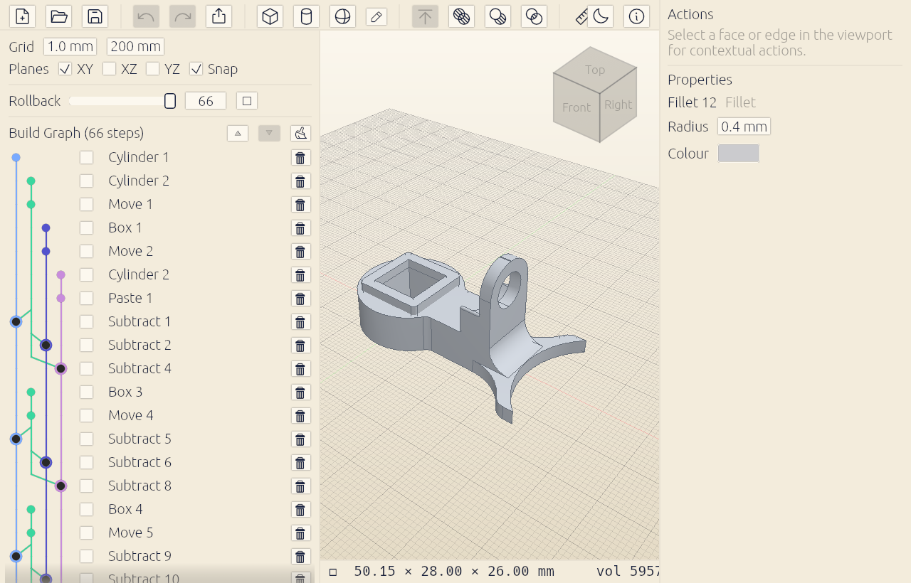

# Cadette

**Powerful. Friendly. Free. Pick all three.**

Cadette is free, open-source parametric CAD for makers — Tinkercad's simplicity,
Shapr3D's spunk, FreeCAD's kernel, nobody's subscription. Model a part, change
any step later, and export a clean STL for your printer.



More at **[cadette.org](https://cadette.org)**.

## Download

- **macOS (Apple silicon):** [cadette-macos-arm64.dmg](https://github.com/chasegan/cadette/releases/latest/download/cadette-macos-arm64.dmg)
  — the app is ad-hoc signed, so the first launch needs **right-click → Open**.
- **Windows / Linux:** coming soon.

## What's inside

- **Direct modeling** — select a face and push/pull it, resize with handles,
  snap to a grid, group bodies and move them together.
- **A real B-rep kernel** — OpenCASCADE, the engine behind FreeCAD: exact
  solids, fillets, booleans, sweeps and revolves. Real geometry, not meshes.
- **Everything parametric** — every action lives in the Build Graph: re-open,
  tweak, re-order or roll back any step and the model rebuilds.
- **A constraint sketcher** — pen and Bézier tools with dimensions and
  constraints, driven by a pure-Rust Levenberg–Marquardt solver.
- **Print-ready output** — STL export, plus `.cdt` project files that keep the
  full parametric history.

## Build from source

You need Rust (1.85+) and OpenCASCADE 7.7 or newer.

```sh
# macOS
brew install opencascade
cargo run -p cdt-app
```

On other platforms (or a non-Homebrew OCCT), point the build at your install:

```sh
export CDT_OCCT_PREFIX=/path/to/occt-prefix   # contains include/opencascade and lib/
cargo run -p cdt-app
```

On Windows, `vcpkg install opencascade --triplet x64-windows` and use
`%VCPKG_ROOT%\installed\x64-windows` as the prefix.

## Workspace layout

| Crate                | What it owns                                             |
|----------------------|----------------------------------------------------------|
| `crates/core`        | Document model: features, history, regeneration, sketches |
| `crates/kernel`      | OpenCASCADE FFI (cxx) — solids, booleans, tessellation   |
| `crates/solver`      | Levenberg–Marquardt sketch-constraint solver             |
| `crates/project`     | The `.cdt` project file: versioned document envelope + extras |
| `crates/session`     | Headless session: document + kernel + solver + cache + undo, serializable report |
| `crates/render`      | wgpu viewport: scene, picking, gizmo, window shell       |
| `crates/interaction` | Selection model                                          |
| `crates/ui`          | egui chrome: Build Graph panel, command bar, theming     |
| `app`                | The Cadette application                                  |

`cargo test --workspace` runs the whole suite (the kernel tests exercise real
OCCT; the render tests create a real GPU device).

## License

[MPL-2.0](LICENSE). Release bundles include OpenCASCADE and its dependencies,
which are licensed under LGPL-2.1 with the OCCT exception.
